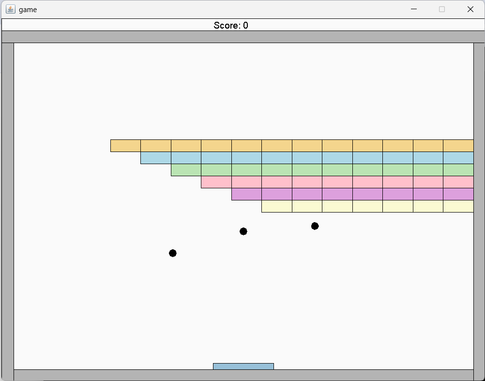
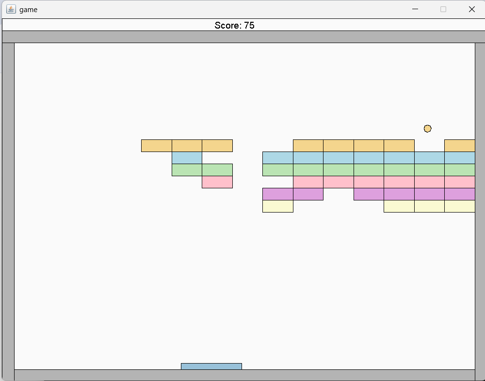

# Arkanoid Game 🧱
*Originally developed during Spring 2025*

A classic Arkanoid/Breakout clone implemented in Java. The player controls a paddle to bounce a ball and destroy all the blocks on the screen without letting the ball fall off the bottom edge.

## Technologies Used
* **Java:** Core game logic and object-oriented design.
* **Apache Ant:** Build automation and execution.
* **GUI Library:** Uses `biuoop-1.4.jar` for graphical rendering and keyboard input.

## Project Structure
* `src/` - Contains all Java source files, organized into packages (`game`, `gameSprites`, `collision`, `geometry`).
* `build.xml` - The Ant build script.
* `biuoop.xml` - Checkstyle configuration for code quality.

## Prerequisites
To compile and run this project, you need to have installed:
1. **Java Development Kit (JDK)**
2. **Apache Ant**

## How to Build and Run

This project uses Ant for build management. Open your terminal in the root directory of the project and run the following commands:

**To compile the project:**
```bash
ant compile
```
**To run the project:**
```bash
ant run
```




